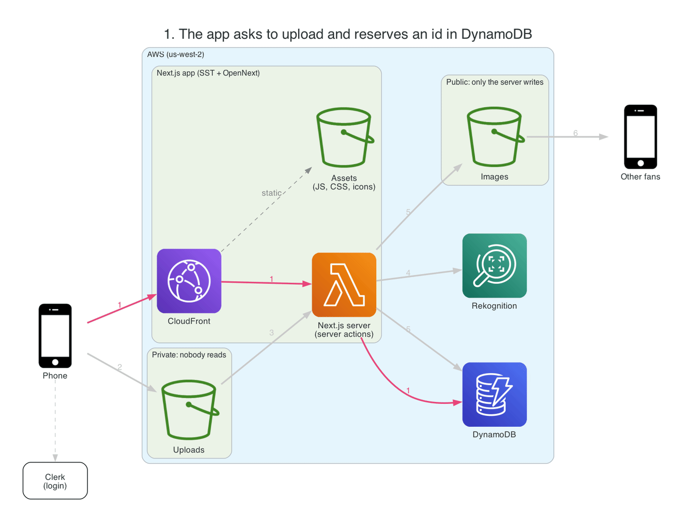

# Freebie Binder

At BTS concerts, fans trade **freebies**: handmade photocards, stickers and bracelets. After a show, many can't remember who gave them each one. Freebie Binder fixes that: each fan uploads a photo of their freebie and shows its QR code, and whoever receives it scans the code to save it in their binder along with the name of the person who made it.

Since anyone can upload a photo that other people will see, **every photo is moderated with Amazon Rekognition before it becomes public**. This repo is the full app, built with Next.js and deployed to AWS with [SST](https://sst.dev).



## How moderation works

1. The app reserves an upload id in DynamoDB and returns a **signed POST** to a **private** S3 bucket (`Uploads`). S3 only accepts files declared as `image/jpeg`, up to 2 MB, within 2 minutes.
2. The browser shrinks the photo to JPEG with a canvas and uploads it straight to that bucket.
3. On publish, the server reads the bytes and checks the JPEG signature.
4. Two Rekognition calls run in parallel on those bytes:
   - [`DetectModerationLabels`](https://docs.aws.amazon.com/rekognition/latest/APIReference/API_DetectModerationLabels.html) with `MinConfidence: 60`. The photo is rejected if any label belongs to a blocked level-1 category (`src/lib/moderation.ts`).
   - [`DetectText`](https://docs.aws.amazon.com/rekognition/latest/APIReference/API_DetectText.html). Lines with confidence of 80 or more must not contain phone numbers, links or messaging apps (`src/lib/text-safety.ts`), the same rule applied to the title and description.
5. Only if both pass does the server copy the photo to the **public** `Images` bucket. The original is deleted either way. If Rekognition fails, nothing is published.
6. Anyone signed in can report a freebie; at 3 reports it hides itself. Admins (Clerk `publicMetadata.role = "admin"`) can hide, restore or delete freebies at `/admin`.

## Stack

| Piece | Role |
| --- | --- |
| Next.js 16 (App Router, server actions) | UI and server logic, on AWS Lambda via [OpenNext](https://opennext.js.org) |
| SST v4 | Infrastructure as code (`sst.config.ts`) |
| Clerk | Sign-in; admin role in `publicMetadata` |
| DynamoDB | Single table: profiles, freebies, binders, upload reservations, rate limits, reports |
| S3 | `Uploads` (private, objects expire after a day) and `Images` (public read, server-only write) |
| Amazon Rekognition | `DetectModerationLabels` and `DetectText` |
| CloudFront | Serves static assets and routes the rest to Lambda |

## Prerequisites

- Node.js 22+ and [pnpm](https://pnpm.io)
- An AWS account and credentials for the AWS CLI (`aws configure` or `aws sso login`)
- A [Clerk](https://clerk.com) application with email and/or Google sign-in

## Deploy

```bash
$ pnpm install
$ cp .env.example .env.local   # fill in your Clerk keys
$ pnpm run deploy dev
```

The deploy prints the app's CloudFront URL.

Settings and secrets come from `.env.local` and `.env.deploy.<stage>` (the second overrides the first). `scripts/deploy.sh` exports the stage file so SST and its providers see it, and `sst.config.ts` passes the app's variables to the Lambda as environment variables. Next.js never loads `.env.deploy.*`, so secrets are not bundled into the Lambda's code. For production, create `.env.deploy.production` with your production Clerk keys and, optionally:

| Variable | Purpose |
| --- | --- |
| `AWS_PROFILE` | AWS CLI profile to deploy with |
| `APP_DOMAIN`, `CLOUDFLARE_ZONE_ID`, `CLOUDFLARE_API_TOKEN`, `CLOUDFLARE_DEFAULT_ACCOUNT_ID` | Custom domain on Cloudflare DNS. Without them the app uses its CloudFront URL |

```bash
$ pnpm run deploy production
```

The production stage keeps three warm Lambda instances, protects the table from deletion and retains its resources on `sst remove`.

### Make yourself admin

In the Clerk dashboard, open your user → **Metadata** → **Public** and set:

```json
{ "role": "admin" }
```

`publicMetadata` can only be set from the backend or the dashboard, so nobody can grant it to themselves from the browser. Non-admins get a 404 at `/admin`.

## Verify

Try Rekognition on a photo before uploading it through the app:

```bash
$ aws rekognition detect-moderation-labels --image-bytes fileb://photo.jpg --min-confidence 60
$ aws rekognition detect-text --image-bytes fileb://photo.jpg
```

Then, in the deployed app, upload a regular photo (it gets published) and one with a phone number written on it (it gets rejected).

Run the unit tests for the moderation rules, text rules, redirects, ids and events:

```bash
$ pnpm test
```

## Clean up

```bash
$ npx sst remove --stage dev
```

This deletes every resource of a non-production stage. Production resources are retained on purpose; delete them from the AWS console if you really want to.

## Cost

Each published photo makes two Rekognition calls, both in the Image API **Group 2**. Check the [Rekognition pricing page](https://aws.amazon.com/rekognition/pricing/) for your region and free tier. Lambda, DynamoDB (on demand), S3 and CloudFront are pay-per-use; the three warm instances in production add a small fixed cost.

## Reuse it for another tour

Tour cities and dates live in `src/lib/events.ts`, and members for the "bias" field in `src/lib/catalog.ts`. UI copy is in `src/lib/i18n/locales/` (Spanish, English, Portuguese, Korean, Japanese, Chinese, French, German and Italian).

## Project structure

```
src/
  app/
    actions/        server actions: upload, freebie, profile, locale
    admin/          moderation panel (admins only)
    binder/ f/[id]/ nuevo/ onboarding/ privacidad/   pages
  components/       shared UI (sleeve, confirm dialog, choice chips, ...)
  lib/
    db/             DynamoDB access, one module per domain
    moderation.ts   Rekognition calls and blocked categories
    text-safety.ts  contact-detail rules for public text
    storage.ts      signed upload, JPEG check, publishing
    events.ts       tour cities and dates
    i18n/           UI copy per language
test/               Vitest unit tests
docs/               architecture diagram, generated by docs/diagram.py
```

## License

[MIT](LICENSE). Freebie Binder is an independent fan project. It is not affiliated with BTS, BIGHIT MUSIC or HYBE.
